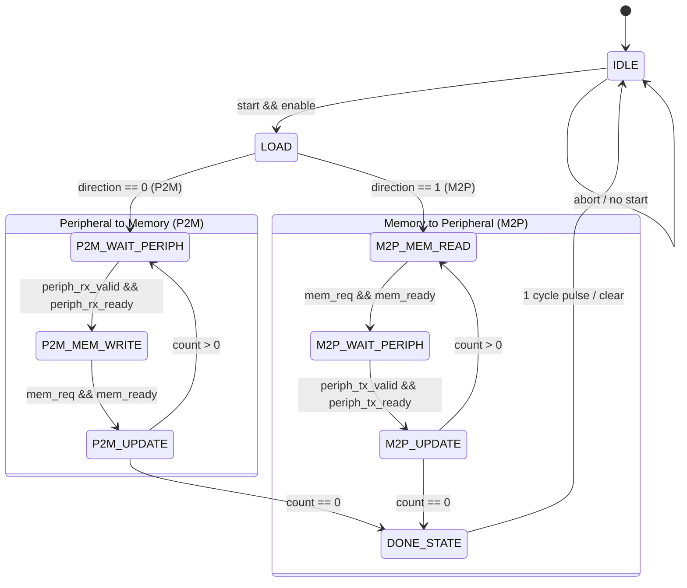

# Implementation Plan: Stage 1 — Programmable 1-Channel DMA Controller

Design and RTL implementation of Stage 1 of the 4-Channel Programmable DMA Controller, establishing the complete single-channel context, control FSM, address generation, transfer counter, peripheral handshake, and memory bus interface before scaling to 4 channels with round-robin arbitration.

---

## User Review Required

> [!IMPORTANT]
> **Sub-Word Memory Byte Alignment & Byte Enables**:
> For non-32-bit transfers (e.g., 8-bit, 16-bit, 24-bit, or arbitrary 1–32 bits), memory write accesses require byte-enable signals (`mem_be[3:0]`). The address step is calculated based on `DATA_WIDTH`:
> - Width 1–8 bits: Byte step (`+1`), `mem_be` asserted for the active byte offset (`addr[1:0]`).
> - Width 9–16 bits: Halfword step (`+2`), 16-bit aligned.
> - Width 17–32 bits: Word step (`+4`), 32-bit aligned.
> Please review the address increment and byte-enable rule in the specification below.

> [!NOTE]
> **Register Map Compatibility**:
> Your existing [rtl/dma_registers.v](file:///D:/PROJECTS/DMA_controller/rtl/dma_registers.v) defines `CONTROL (0x00)`, `STATUS (0x04)`, `SRC_ADDR (0x08)`, `DST_ADDR (0x0C)`, and `TRANSFER_LEN (0x10)`. We will extend `CONTROL` and `STATUS` with dedicated control bits and add `DATA_WIDTH (0x14)` to maintain 100% compatibility with your initial draft.

---

## Open Questions

1. **Done Flag Clearing**: Should `done` in the `STATUS` register be cleared automatically upon writing `1` to `start`, cleared by writing `1` to bit 1 of `STATUS` (W1C), or both? (Proposed default: cleared automatically when a new transfer starts, plus writable W1C).
2. **Peripheral Handshake Polarity**: Is active-high standard ready/valid handshake (`valid && ready`) preferred for peripheral integration, or do you require traditional active-low DREQ/DACK handshake signals? (Proposed default: standard active-high `valid`/`ready` streaming handshake).

---

## Technical Specification: 1-Channel DMA Controller

```
                                  +-------------------------------------------------------+
                                  |                     dma_channel                       |
                                  |                                                       |
        Host CPU Bus -----------> |   +--------------------+     +--------------------+   |
        (reg_write, reg_read,     |   |   dma_registers    |     |      dma_fsm       |   |
         reg_addr, wdata, rdata)  |   |                    |     |                    |   |
                                  |   | - CONTROL (0x00)   |     | States:            |   |
                                  |   | - STATUS  (0x04)   |---->| - IDLE             |   |
                                  |   | - SRC_ADDR(0x08)   |     | - LOAD             |   |
                                  |   | - DST_ADDR(0x0C)   |     | - WAIT_PERIPH_RX   |   |
                                  |   | - LEN     (0x10)   |     | - MEM_WRITE        |   |
                                  |   | - WIDTH   (0x14)   |     | - MEM_READ         |   |
                                  |   +--------------------+     | - WAIT_PERIPH_TX   |   |
                                  |              |               | - UPDATE / DONE    |   |
                                  |              v               +--------------------+   |
                                  |   +-----------------------------------------------+   |
                                  |   |                 dma_datapath                  |   |
                                  |   |                                               |   |
                                  |   |  - curr_src_addr, curr_dst_addr (addr_gen)    |   |
                                  |   |  - transfer_counter (down-counter to 0)       |   |
                                  |   |  - 32-bit data_buffer with width mask         |   |
                                  |   +-----------------------------------------------+   |
                                  +-----------------------|------------------|------------+
                                                          |                  |
                                  Peripheral Interface    v                  v    Memory Master Interface
                                  (rx_valid, rx_ready,            (mem_req, mem_we, mem_addr,
                                   rx_data, tx_valid,              mem_wdata, mem_rdata,
                                   tx_ready, tx_data)              mem_be, mem_ready)
```

### 1. Module Port List (`dma_channel.v`)

| Port Name | Direction | Width | Description |
| :--- | :--- | :--- | :--- |
| `clk` | Input | 1 | Global system clock |
| `rst_n` | Input | 1 | Synchronous active-low reset |
| **CPU Register Interface** | | | |
| `reg_write` | Input | 1 | CPU register write strobe |
| `reg_read` | Input | 1 | CPU register read strobe |
| `reg_addr` | Input | 8 | Register byte address (`0x00` – `0x14`) |
| `reg_wdata` | Input | 32 | CPU write data bus |
| `reg_rdata` | Output | 32 | CPU read data bus |
| **Peripheral Interface** | | | |
| `periph_rx_valid` | Input | 1 | Peripheral has valid data for DMA (P2M mode) |
| `periph_rx_ready` | Output | 1 | DMA is ready to receive peripheral data |
| `periph_rx_data` | Input | 32 | Data from peripheral |
| `periph_tx_valid` | Output | 1 | DMA has valid data for peripheral (M2P mode) |
| `periph_tx_ready` | Input | 1 | Peripheral is ready to accept data from DMA |
| `periph_tx_data` | Output | 32 | Data to peripheral |
| **Memory Master Interface** | | | |
| `mem_req` | Output | 1 | Memory transaction request (valid) |
| `mem_we` | Output | 1 | 1 = Write to memory, 0 = Read from memory |
| `mem_addr` | Output | 32 | 32-bit target memory address |
| `mem_wdata` | Output | 32 | 32-bit write data to memory |
| `mem_be` | Output | 4 | 4-bit byte enable strobe |
| `mem_rdata` | Input | 32 | 32-bit read data from memory |
| `mem_ready` | Input | 1 | Memory slave ready/acknowledge response |
| **Interrupt / Event** | | | |
| `irq` | Output | 1 | Transfer complete interrupt pulse/level |

---

### 2. Register Map & Bit Definitions

Base offset for Channel 0: `0x00` (In Stage 2, channels 1–3 will replicate at `0x20`, `0x40`, `0x60`).

| Address | Name | Access | Reset | Description |
| :--- | :--- | :--- | :--- | :--- |
| `0x00` | `CONTROL` | R/W | `0x00000000` | Control register |
| `0x04` | `STATUS` | R/W1C | `0x00000000` | Status register |
| `0x08` | `SRC_ADDR` | R/W | `0x00000000` | Source starting address |
| `0x0C` | `DST_ADDR` | R/W | `0x00000000` | Destination starting address |
| `0x10` | `TRANSFER_LEN` | R/W | `0x00000000` | Number of transfers (1 to $2^{32}-1$) |
| `0x14` | `DATA_WIDTH` | R/W | `0x00000020` | Data width in bits (default = 32) |

#### `CONTROL` (`0x00`) Bit Fields:
- `[0]` - `START`: Write `1` to initiate DMA transfer (self-clearing pulse).
- `[1]` - `ENABLE`: Channel master enable (`1` = active, `0` = disabled).
- `[2]` - `DIRECTION`: Transfer direction (`0` = Peripheral $\to$ Memory, `1` = Memory $\to$ Peripheral).
- `[3]` - `SRC_INC`: Source address increment (`1` = post-increment, `0` = fixed/constant).
- `[4]` - `DST_INC`: Destination address increment (`1` = post-increment, `0` = fixed/constant).
- `[5]` - `IRQ_EN`: Interrupt enable on transfer completion (`1` = enable, `0` = mask).
- `[6]` - `ABORT`: Write `1` to stop ongoing transfer and return to `IDLE`.

#### `STATUS` (`0x04`) Bit Fields:
- `[0]` - `BUSY`: Active high while DMA operation is in progress.
- `[1]` - `DONE`: Set high when transfer count reaches 0. Cleared on `START` or writing `1`.
- `[2]` - `ERROR`: Set high if transfer aborted or bus error detected.

#### `DATA_WIDTH` (`0x14`) Bit Fields:
- `[5:0]` - `WIDTH`: Data width per transfer (1 to 32 bits).
  - Values $1 \dots 8 \implies$ byte step (+1).
  - Values $9 \dots 16 \implies$ halfword step (+2).
  - Values $17 \dots 32 \implies$ word step (+4).

---

### 3. FSM State Diagram & Transitions



#### FSM State Descriptions:
1. **`IDLE`**: Channel inactive. Monitors `start && enable`.
2. **`LOAD`**: Loads shadow registers from configuration registers:
   - `curr_src_addr <= src_addr`
   - `curr_dst_addr <= dst_addr`
   - `rem_count <= transfer_len`
   - Sets `busy <= 1'b1`, clears previous `done <= 1'b0`.
3. **`P2M_WAIT_PERIPH`**: Asserts `periph_rx_ready = 1`. Latches `periph_rx_data` into `data_buffer` when handshake succeeds.
4. **`P2M_MEM_WRITE`**: Asserts `mem_req = 1`, `mem_we = 1`, `mem_addr = curr_dst_addr`, `mem_wdata = data_buffer`, and appropriate `mem_be`. Waits for `mem_ready`.
5. **`P2M_UPDATE`**: Decrements `rem_count <= rem_count - 1`. If `dst_inc == 1`, increments `curr_dst_addr += addr_step`. If `src_inc == 1`, increments `curr_src_addr += addr_step`. Checks completion.
6. **`M2P_MEM_READ`**: Asserts `mem_req = 1`, `mem_we = 0`, `mem_addr = curr_src_addr`. On `mem_ready`, latches `mem_rdata` into `data_buffer`.
7. **`M2P_WAIT_PERIPH`**: Asserts `periph_tx_valid = 1`, `periph_tx_data = data_buffer`. Waits for `periph_tx_ready`.
8. **`M2P_UPDATE`**: Decrements `rem_count <= rem_count - 1`. If `src_inc == 1`, increments `curr_src_addr += addr_step`. If `dst_inc == 1`, increments `curr_dst_addr += addr_step`. Checks completion.
9. **`DONE_STATE`**: Sets `busy <= 1'b0`, `done <= 1'b1`, asserts `irq` if `irq_en == 1`. Returns to `IDLE`.

---

## Proposed Changes

### RTL Implementation Components

#### [MODIFY] [rtl/dma_registers.v](file:///D:/PROJECTS/DMA_controller/rtl/dma_registers.v)
- Upgrade `dma_registers` to support full `CONTROL` bitfield (`enable`, `direction`, `src_inc`, `dst_inc`, `irq_en`, `abort`), `STATUS` W1C behavior, and `DATA_WIDTH` register (`0x14`).

#### [NEW] [rtl/dma_fsm.v](file:///D:/PROJECTS/DMA_controller/rtl/dma_fsm.v)
- Implement state machine handling `IDLE`, `LOAD`, `P2M_WAIT_PERIPH`, `P2M_MEM_WRITE`, `P2M_UPDATE`, `M2P_MEM_READ`, `M2P_WAIT_PERIPH`, `M2P_UPDATE`, `DONE_STATE`.
- Generate ready/valid strobes for peripheral and memory buses.

#### [NEW] [rtl/dma_datapath.v](file:///D:/PROJECTS/DMA_controller/rtl/dma_datapath.v)
- Current address generators (`curr_src_addr`, `curr_dst_addr`) with programmable increment (`+1`, `+2`, `+4`).
- Down-counter for remaining transfer items.
- 32-bit data buffer with bit-width masking and byte-enable (`mem_be[3:0]`) generator.

#### [NEW] [rtl/dma_channel.v](file:///D:/PROJECTS/DMA_controller/rtl/dma_channel.v)
- Top-level single channel module combining `dma_registers`, `dma_fsm`, and `dma_datapath`.
- Will serve as the reusable building block duplicated 4 times in Stage 4.

#### [NEW] [rtl/dma_controller.v](file:///D:/PROJECTS/DMA_controller/rtl/dma_controller.v)
- Wraps `dma_channel` for Stage 1. Exposes peripheral and memory interfaces.

---

### Verification & Documentation

#### [NEW] [tb/tb_dma_memory.v](file:///D:/PROJECTS/DMA_controller/tb/tb_dma_memory.v)
- Behavioral 32-bit SRAM model with byte-enable support (`mem_be[3:0]`), configurable access latency, and memory dump/inspect tasks.

#### [NEW] [tb/tb_dma_channel.v](file:///D:/PROJECTS/DMA_controller/tb/tb_dma_channel.v)
- Dedicated single-channel self-checking testbench testing:
  1. Register read/write and reset values.
  2. Peripheral $\to$ Memory transfer: 8-bit, 16-bit, and 32-bit modes.
  3. Memory $\to$ Peripheral transfer: 8-bit, 16-bit, and 32-bit modes.
  4. Address increment vs fixed address verification.
  5. Back-to-back transfers and completion interrupt checks.
  6. VCD waveform dumping for GTKWave analysis.

#### [MODIFY] [docs/architecture.md](file:///D:/PROJECTS/DMA_controller/docs/architecture.md)
- Populate architecture documentation with block diagrams, FSM, and memory/peripheral interface specifications.

#### [MODIFY] [docs/registers_map.md](file:///D:/PROJECTS/DMA_controller/docs/registers_map.md)
- Populate register map and programming sequence guide.

---

## Verification Plan

### Automated Simulation via Icarus Verilog
We will compile and run simulations directly using the installed `iverilog` (v0.9.7) and `vvp`:

```powershell
# 1. Compile 1-channel DMA and testbench
iverilog -Wall -g2005 -o build/sim_channel.vvp rtl/dma_registers.v rtl/dma_fsm.v rtl/dma_datapath.v rtl/dma_channel.v tb/tb_dma_memory.v tb/tb_dma_channel.v

# 2. Run simulation
vvp build/sim_channel.vvp
```

### Test Cases Covered in `tb_dma_channel.v`:
1. **TC1: Register Access & Defaults**: Read reset values, verify R/W to `SRC_ADDR`, `DST_ADDR`, `TRANSFER_LEN`, `DATA_WIDTH`, `CONTROL`.
2. **TC2: Peripheral-to-Memory (P2M, 32-bit, Length = 8)**: Peripheral stream writes 8 words to Memory `0x1000..0x101C`. Check memory content and `done == 1`.
3. **TC3: Peripheral-to-Memory (P2M, 8-bit, Length = 16)**: Peripheral stream writes 16 bytes to Memory `0x2000..0x200F`. Verify byte enables and address increment by 1.
4. **TC4: Memory-to-Peripheral (M2P, 32-bit, Length = 4)**: Memory pre-loaded with pattern; DMA reads memory and transfers to peripheral. Verify peripheral received sequence.
5. **TC5: Fixed Peripheral Address vs Incremented Memory Address**: Ensure peripheral address stays constant while memory address increments.
6. **TC6: Interrupt Assertion & Status Clear**: Verify `irq` pulses when transfer finishes and status register updates correctly.
